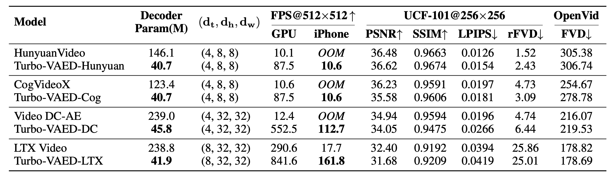
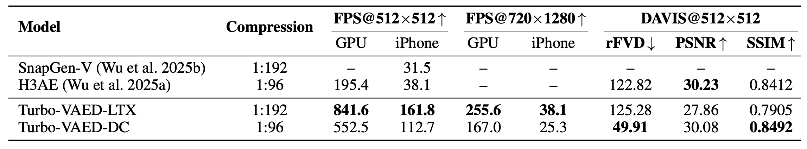

<div align="center">
<h1> Turbo-VAED </h1>
<h2>Fast and Stable Transfer of Video-VAEs to Mobile Devices</h2>

**_Mobile Video VAEs Trained with Only One RTX 4090 GPU!_**

Ya Zou<sup>\*</sup>, [Jingfeng Yao](https://github.com/JingfengYao)<sup>\*</sup>, Siyuan Yu, [Shuai Zhang](https://github.com/Shuaizhang7), [Wenyu Liu](http://eic.hust.edu.cn/professor/liuwenyu), [Xinggang Wang](https://xwcv.github.io/index.htm)<sup>📧</sup>

Huazhong University of Science and Technology (HUST) 

(\* equal contribution, 📧 corresponding author: xgwang@hust.edu.cn)

[](https://arxiv.org/abs/2508.09136)
[](https://huggingface.co/hustvl/Turbo-VAED)

</div>

<div align="center">

</div>

## 📰 News

- **[2026.07.09]** We have released **Turbo-VAED-Wan2.2-TI2V-5B**, a distilled VAE decoder for Wan2.2-TI2V-5B. The checkpoint is available on [Hugging Face](https://huggingface.co/zy12123/Turbo-VAED-Wan2.2-TI2V-5B).

- **[2025.11.29]** Check our [MobileI2V](https://github.com/hustvl/MobileI2V), a **270M tiny videogen model** on the mobile! **Turbo-VAED helps 3 times decoding speedup**.

- **[2025.11.08]** Turbo-VAED is accepted by AAAI 2026! 🎉🎉🎉

- **[2025.09.04]** We have released the pre-trained weights!

- **[2025.08.25]** We have released the code, and the weights will be available soon.

- **[2025.08.13]** We have released our paper on [arXiv](https://arxiv.org/abs/2508.09136).

## 📄 Introduction

There is a growing demand for deploying large generative AI models on mobile devices. For recent popular video generative models, however, the Variational AutoEncoder (VAE) represents one of the major computational bottlenecks. Both large parameter sizes and mismatched kernels cause out-of-memory errors or extremely slow inference on mobile devices. To address this, we propose a low-cost solution that efficiently transfers widely used video VAEs to mobile devices. 

(1) We analyze redundancy in existing VAE architectures and get empirical design insights. By integrating 3D depthwise separable convolutions into our model, we significantly reduce the number of parameters. 

(2) We observe that the upsampling techniques in mainstream video VAEs are poorly suited to mobile hardware and form the main bottleneck. In response, we propose a decoupled 3D pixel shuffle scheme that slashes end-to-end delay. Building upon these, we develop a universal mobile-oriented VAE decoder, **Turbo-VAED**. 

(3) We propose an efficient VAE decoder training method. Since only the decoder is used during deployment, we distill it to Turbo-VAED instead of retraining the full VAE, enabling fast mobile adaptation with minimal performance loss. 

To our knowledge, our method enables real-time 720p video VAE decoding on mobile devices for the first time. This approach is widely applicable to most video VAEs. When integrated into four representative models, with training cost as low as $95, it accelerates original VAEs by up to 84.5× at 720p resolution on GPUs, uses as low as 17.5% of original parameter count, and retains 96.9% of the original reconstruction quality. Compared to mobile-optimized VAEs, Turbo-VAED achieves a 2.9× speedup in FPS and better reconstruction quality on the iPhone 16 Pro.

## 📝 Results

<div align="center">

</div>

<div align="center">

</div>


## 🎯 How to Use

### Installation

```
conda create -n turbovaed python=3.10.0
conda activate turbovaed
pip install -r requirements.txt
```

## 🚀 Get Turbo-VAED-Wan

We release **Turbo-VAED-Wan2.2-TI2V-5B**, a lightweight distilled VAE decoder for [Wan2.2-TI2V-5B](https://huggingface.co/Wan-AI/Wan2.2-TI2V-5B-Diffusers).

The checkpoint is available on [Hugging Face](https://huggingface.co/zy12123/Turbo-VAED-Wan2.2-TI2V-5B).

### Performance

| Decoder | FPS ↑ | FLOPs / video (T) ↓ | PSNR ↑ | SSIM ↑ |
|:--|--:|--:|--:|--:|
| [Wan2.2-TI2V-5B VAE](https://huggingface.co/Wan-AI/Wan2.2-TI2V-5B-Diffusers) | 27.61 | 20.780 | **36.24** | **0.9624** |
| **Turbo-VAED-Wan** | **53.72** | **5.868** | 35.52 | 0.9620 |

Turbo-VAED-Wan achieves a **1.95× decoding speedup** and **71.8% FLOPs reduction** on one NVIDIA L4 GPU using BF16, while maintaining comparable reconstruction quality.

<p align="center">
  <a href="images/wan_comparison/comparison.mp4">
    
  </a>
</p>

<p align="center">
  Wan2.2-TI2V-5B VAE vs. Turbo-VAED-Wan
</p>

### Quick Start

```bash
python demo_wan.py \
  --input_video path/to/input.mp4 \
  --teacher_model Wan-AI/Wan2.2-TI2V-5B-Diffusers \
  --checkpoint path/to/Turbo-VAED-Wan2.2-TI2V-5B.ckpt \
  --num_frames 17 \
  --output_dir outputs/wan_demo
```

Turbo-VAED-Wan is a plug-and-play replacement for the original Wan2.2 VAE decoder, using the same latent inputs without changing the rest of the pipeline.

You can also try the third-party Turbo-VAED decoder from [daVinci-MagiHuman](https://github.com/GAIR-NLP/daVinci-MagiHuman). Thanks for sharing it.

## 🎮 Train Your Own Models

* Downloads Video Datasets & Teacher Models

You can download video datasets such as [VidGen](https://huggingface.co/datasets/Fudan-FUXI/VIDGEN-1M) and [UCF-101](https://www.crcv.ucf.edu/data/UCF101.php). The video data should be placed in a root directory, which may consist of multiple subdirectories.

You can download [LTX-VAE](https://huggingface.co/Lightricks/LTX-Video/tree/main/vae), [Hunyuan-VAE](https://huggingface.co/hunyuanvideo-community/HunyuanVideo/tree/main/vae), [CogVideoX-VAE](https://huggingface.co/zai-org/CogVideoX1.5-5B/tree/main/vae), or any other video VAE you want to distill.

* (Optional) You can pre-generate and save latents for small video datasets to reduce the computational cost of encoding during training.
```
python train_vae/generate_latents.py
```
And you can use the dataset implementation in `train_vae/dataset/video_latent_dataset.py` for training.

*  You need to modify some necessary paths as required in `train.sh`.

* Run the following command to start training.
```
bash train.sh
```

* Try using the trained model to reconstruct videos! Run the following command:
```
python validation_videos.py
```

* Calculate metrics.

You can download the [pretrained weights](https://www.dropbox.com/s/ge9e5ujwgetktms/i3d_torchscript.pt
) required for calculating rFVD, modify the corresponding paths for loading the model weights and validation dataset directory in the code, and run the following code to compute the rFVD, PSNR, LPIPS, and SSIM metrics.
```
torchrun --nnodes=1 --nproc_per_node=1 train_vae/validation_metrics.py
```

## ❤️ Acknowledgements

Our Turbo-VAED codes are mainly built with [Open-Sora-Plan](https://github.com/PKU-YuanGroup/Open-Sora-Plan) and [diffusers](https://github.com/huggingface/diffusers). Thanks for all these great works.

## 📝 Citation

If you find Turbo-VAED useful, please consider giving us a star 🌟 and citing it as follows:

```
@misc{zou2025turbovaedfaststabletransfer,
      title={Turbo-VAED: Fast and Stable Transfer of Video-VAEs to Mobile Devices}, 
      author={Ya Zou and Jingfeng Yao and Siyuan Yu and Shuai Zhang and Wenyu Liu and Xinggang Wang},
      year={2025},
      eprint={2508.09136},
      archivePrefix={arXiv},
      primaryClass={cs.CV},
      url={https://arxiv.org/abs/2508.09136}, 
}

```
